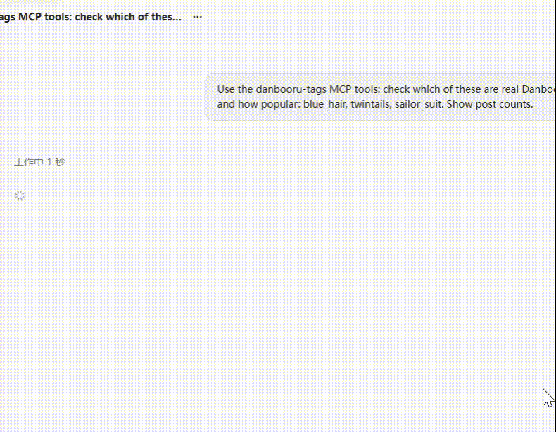

# danbooru-tag-mcp

[](https://github.com/BaixuanZhu/danbooru-tag-mcp/actions/workflows/ci.yml)
[](https://github.com/BaixuanZhu/danbooru-tag-mcp/releases/latest)
[](https://go.dev)
[](LICENSE)

A Danbooru tag lookup [MCP](https://modelcontextprotocol.io) (Model Context
Protocol) server for local AI image generation: your AI client resolves real
Danbooru tags — exact names, aliases, categories, post counts, co-occurrence
statistics, wiki descriptions, and the tag lists of real posts — before
composing prompts, which noticeably improves tag accuracy in generated images.

<p align="center">
  
</p>

## Quick start

Install per-user (Windows 10/11, no admin rights):

```powershell
iwr -useb "https://raw.githubusercontent.com/BaixuanZhu/danbooru-tag-mcp/main/install.ps1" | iex
```

Point your MCP client at the command:

```json
{
  "mcpServers": {
    "danbooru-tags": {
      "command": "danbooru-tag-mcp",
      "args": []
    }
  }
}
```

That's it — the client picks up the eight tools below on its next session.

## Features

- **8 MCP tools**: tag search, exact tag info, batch tag lookup, related tags, alias resolution, wiki lookup, post search, and tag distribution profiles
- **Batch tag lookup**: `get_tags_info` resolves up to 20 exact tag names in a single request — one tool call instead of 20, with found/missing split and a `wd14` verdict on every name
- **Tag distribution profiles, single or pair**: `get_tag_profile` samples a page of a big tag's posts and answers what it actually renders as — co-occurring tags by in-sample frequency (corpus constants like `1girl`/`solo` split into `ubiquitous`), combinations ranked by lift, and the sample's rating mix. `with` profiles a tag pair over the 200 most recent joint posts (what does `arm_up` + `holding_weapon` render as?); `order: score/favcount` switches to a top-post view (biased), `rating:` narrows either mode
- **Structured wiki pages**: `get_tag_wiki` distills the DText body into `summary`, `intro_tags` (definition/appearance tag targets), `rules` (the "if X, use Y instead" disambiguation sentences), `see_also` and `example_posts` — no raw body to re-parse; `include_description` opts into the intro prose as plain text for character appearance descriptions
- **Tag lists back from post search**: `search_posts` returns each post's full tag list split by category (copyright/artist/character/general/meta) plus `score`/`fav_count`/`large_file_url`, so mining a few posts reveals which tags naturally go together
- **Tagger-era tag detection**: `get_tag_info` classifies every name against the pinned WD14 tagger vocabularies (`wd14` field: `live` / `tagger_era` — a tagger-era name Danbooru has since renamed, with the canonical name in `renamed_to` / `unknown`), so LoRA card captions stop dead-ending at "tag not found"; `search_tags` adds `wd14_hits` fallback hits when no result carries posts, and filters by category (general/artist/copyright/character/meta) so character or artist lookups stop drowning in general tags
- **Uncensored by default**: `search_posts` applies no rating filter — results reflect a tag's whole population (arm_up is ~95% g/s/q); add a `rating:g/s/q/e` metatag when you want only R-18 or only all-ages
- **Outage-tolerant**: repeat queries are served from an on-disk response cache (posts never); when Danbooru is unreachable, the last cached answer is served stale — marked `stale` + `cached_at` — after automatic retries, and HTML maintenance error pages collapse to a one-line summary
- **Self-updating**: `danbooru-tag-mcp upgrade` checks GitHub Releases, verifies SHA256 and replaces the binary atomically
- **Zero-config install**: per-user installer (setup wizard or one-line PowerShell) that registers the install directory into the user PATH automatically
- **Polite API usage**: requests are throttled to one per 1.5 seconds anonymous (500ms with credentials, both tunable via `DANBOORU_REQ_GAP_MS`); anonymous access works, credentials raise the limits (free/anonymous post searches are still capped at 2 content tags per query)

## Install

Requires Windows 10/11 on x64 or ARM64.

### Option 1: setup wizard (recommended)

Download `danbooru-tag-mcp-windows-<arch>-setup.exe` from the
[latest release](https://github.com/BaixuanZhu/danbooru-tag-mcp/releases/latest)
and double-click it. This installs per-user to
`%LOCALAPPDATA%\Programs\danbooru-tag-mcp` (no admin rights needed) and
registers the user PATH.

### Option 2: one-line PowerShell

```powershell
iwr -useb "https://raw.githubusercontent.com/BaixuanZhu/danbooru-tag-mcp/main/install.ps1" | iex
```

Custom install directory:

```powershell
.\install.ps1 -InstallDir "D:\tools\danbooru-tag-mcp"
```

### Option 3: portable zip

Download `danbooru-tag-mcp-windows-<arch>.zip` from the
[release page](https://github.com/BaixuanZhu/danbooru-tag-mcp/releases),
extract `danbooru-tag-mcp.exe` anywhere, and run it once — the first run
silently adds its own directory to the user PATH (idempotent).

### Option 4: ZCode / Claude Code plugin (auto MCP config)

For ZCode and Claude Code users the MCP configuration can come from a plugin
instead of hand-edited JSON: add this repository as a plugin marketplace and
install `danbooru-tag-mcp` — the plugin ships the `danbooru-tags` server
definition, so no client-side config is needed.

- **ZCode**: Plugin Marketplace → Add → `BaixuanZhu/danbooru-tag-mcp` →
  install the `danbooru-tag-mcp` plugin.
- **Claude Code**: `/plugin install danbooru-tag-mcp --marketplace BaixuanZhu/danbooru-tag-mcp`
  (one step, Claude Code 2.1.275+), or add the marketplace first with
  `claude plugin marketplace add BaixuanZhu/danbooru-tag-mcp` and install
  from there.

The plugin wires the configuration only — the CLI still has to be on PATH
(install it first via Option 1-3 above), and `danbooru-tag-mcp upgrade`
keeps it updated independently of the plugin. See
[plugins/danbooru-tag-mcp/README.md](plugins/danbooru-tag-mcp/README.md).

## Configure your MCP client

Point your MCP client (Claude Desktop, ZCode, etc.) at the command:

```json
{
  "mcpServers": {
    "danbooru-tags": {
      "command": "danbooru-tag-mcp",
      "args": []
    }
  }
}
```

The bare command name works because the install directory is on the user PATH;
alternatively use the full exe path. ZCode and Claude Code users can skip the
manual JSON entirely via [Option 4](#option-4-zcode--claude-code-plugin-auto-mcp-config).

## Tools

| Tool | Description | Parameters |
|------|-------------|------------|
| `search_tags` | Search tags by keyword, ordered by post count; when no result has posts, adds `wd14_hits` (WD14 tagger vocab names containing the query); optional category filter | `query` (required, e.g. `blue hair`), `limit` (default 10), `category` (one of `general`/`artist`/`copyright`/`character`/`meta`), `min_posts` (default 0, drops tags below the threshold), `refresh` (default false) |
| `get_tag_info` | Exact info for one tag (category, post count), plus a `wd14` verdict: `live` (current Danbooru), `tagger_era` (WD14 tagger vocab only, likely renamed — see `renamed_to` / `get_tag_alias`), `unknown` (neither). A 0-post name with an active alias also returns `renamed_to` (the canonical tag) | `name` (required, e.g. `blue_hair`), `refresh` (default false) |
| `get_tags_info` | Batch version of `get_tag_info`: up to 20 exact names in one request; returns `found` (each with the same fields as `get_tag_info`, including `renamed_to` on 0-post rows) and `missing` (names absent from Danbooru, each still carrying its `wd14` verdict) | `names` (required, e.g. `["blue_hair","1girl"]`, max 20), `refresh` (default false) |
| `get_related_tags` | Tags that co-occur with the given tag (meta-category tags like `highres` are filtered out as noise) | `tag` (required), `limit` (default 10), `refresh` (default false) |
| `get_tag_alias` | Resolve an alias or misspelling to its canonical tag (`null` = input is already canonical) | `name` (required, e.g. `sailor_suit`), `refresh` (default false) |
| `get_tag_wiki` | Wiki page of a tag as structured fields: `summary` (first paragraph), `intro_tags` (definition-section link targets), `rules` (disambiguation/usage sentences), `see_also`, `example_posts`, plus the raw `linked_tags` union and multilingual `other_names`. The raw DText body is not returned; opt into `include_description` for the intro prose as plain text (character appearance descriptions) | `title` or `other_names` (one required), `limit` (default 5), `include_description` (default false), `refresh` (default false) |
| `search_posts` | Search posts by a tag combination, no rating filter by default (add a `rating:g/s/q/e` metatag to narrow). Each post carries `score`, `fav_count`, `large_file_url` and `tags` split by category: `copyright` / `artist` / `character` / `general` / `meta` | `tags` (required, space-separated), `limit` (default 5, max 20), `tags_mode` (`full` default, `none` drops the per-post tag lists, `diff` keeps only tags not already in the query) |
| `get_tag_profile` | Distribution profile of one tag from a post sample (default 200, random = whole population): `co_tags` ordered by in-sample frequency, `ubiquitous` corpus constants (`freq >= 0.5`), `top_pairs` combinations ranked by lift, `ratings` mix. `order` picks random (default) / `score` / `favcount` (top-post biased); `rating` filters the sample; `with` profiles the 200 most recent joint posts of a tag pair instead | `tag` (required, e.g. `arm_up`), `sample` (default 200, range 20-200), `with`, `rating` (`g`/`s`/`q`/`e`), `order` |

The six tag tools (`search_tags`, `get_tag_info`, `get_tags_info`,
`get_related_tags`, `get_tag_alias`, `get_tag_wiki`) read from the
[response cache](#response-cache): repeat calls inside the TTL skip the
network round trip, and during a Danbooru outage the last cached answer is
served instead of an error, marked with `stale: true` and `cached_at` (when
it was stored). Their `refresh` parameter (default false) bypasses the cache
for a single call and re-fetches live. Post search and profiles are never
cached, so they carry no `refresh`.

## Response cache

Repeat queries are answered from an on-disk cache instead of hitting Danbooru
again:

| Data | TTL |
|------|-----|
| Related tags (`get_related_tags`) | 30 days |
| Wiki pages, aliases | 7 days |
| Tag searches (`search_tags`) | 24 hours |
| Exact tag lookups (`get_tag_info`, `get_tags_info`) | 7 days |
| Posts (`search_posts`, `get_tag_profile`) | never cached |

- Location: `%LOCALAPPDATA%\danbooru-tag-mcp\cache` (per user, persists
  across restarts, capped at 2000 entries / 64 MB with oldest-first
  eviction). It holds only API response bodies and is safe to delete at any
  time; the uninstaller removes it.
- Fresh hits are served byte-identically to a network response — no markers.
- When Danbooru is unreachable (after retries), the expired cached answer is
  served instead of an error, marked `stale: true` plus `cached_at` (when it
  was stored) on the affected tool response.
- Empty results (`[]`) are never cached, so new tags appear as soon as
  Danbooru knows them.
- Exact tag lookups keep a tag's identity row for 7 days (like wiki pages,
  name and category barely change), so `post_count` can trail live Danbooru
  by up to 7 days — use `refresh: true` when a decision needs current
  counts.
- `refresh: true` re-fetches live and restarts the entry's TTL clock.
- Set `DANBOORU_MCP_NO_CACHE=1` to disable the cache entirely (useful for
  debugging).

## CLI

```
danbooru-tag-mcp            run the MCP server (what MCP clients launch)
danbooru-tag-mcp upgrade    self-update via GitHub Release (SHA256 verified)
danbooru-tag-mcp version    print the version
danbooru-tag-mcp help       show help
```

## Environment variables

- `DANBOORU_LOGIN` — your Danbooru account name (the login you use on the
  site). Optional.
- `DANBOORU_API_KEY` — your Danbooru API key, generated from the API key
  section of your Danbooru profile. Optional. When both `DANBOORU_LOGIN` and
  `DANBOORU_API_KEY` are set, every request is sent authenticated with your
  account (higher rate limits and content access); otherwise the client is
  anonymous and Danbooru applies lower limits.
- `DANBOORU_REQ_GAP_MS` — minimum spacing between Danbooru requests, in
  milliseconds. `0` disables the gap; invalid values fall back to the
  default with a warning. Defaults: 1500 (anonymous) or 500 when
  `DANBOORU_LOGIN` and `DANBOORU_API_KEY` are both set.
- `DANBOORU_MCP_NO_BOOTSTRAP` — skip the startup PATH registration when
  non-empty.
- `DANBOORU_MCP_NO_CACHE` — disable the [response cache](#response-cache)
  when non-empty.

## Building from source

Requires Go 1.26+ and GNU Make (bundled with Git Bash):

```bash
make test        # unit tests
make integration # online smoke test against the live Danbooru API (~1 min)
make build       # dev build -> dist/<arch>/ (bootstrap disabled)
make release     # portable zip + checksums.txt
make installer   # NSIS setup exe (requires makensis: scoop install nsis)
```

Releases are automated: pushing a `v*` tag makes GitHub Actions run the test
suite and publish the setup exes, portable zips, and `checksums.txt` for both
architectures.

## Reproducible builds & verifying downloads

Release binaries are **not** Authenticode-signed; integrity rests on
reproducible builds plus SHA-256, all free and verifiable by anyone:

- The exe and portable zips are **byte-reproducible**: the exact Go toolchain
  is pinned in `go.mod`, builds use `CGO_ENABLED=0 -trimpath -buildvcs=false`,
  and zips are written by `scripts/zipfile` with entry timestamps pinned to
  the commit time (`SOURCE_DATE_EPOCH`). Same source + toolchain ⇒ identical
  bytes on any machine, any timezone.
- Every release job runs a **verify-repro** check: it rebuilds the exe from
  the tagged source on a Linux runner and compares it byte-for-byte against
  the published Windows-built asset — a green check on the release proves
  the artifacts were built from the tag without tampering.
- All artifacts carry **SHA-256 checksums** (`checksums.txt`) and free
  keyless **build-provenance attestations** signed by the GitHub workflow.

Verify a download:

```bash
sha256sum -c --ignore-missing checksums.txt   # integrity vs the manifest
gh attestation verify --repo BaixuanZhu/danbooru-tag-mcp danbooru-tag-mcp.exe   # provenance
```

Reproduce the portable exe yourself and compare:

```bash
git checkout v0.4.0
make build-dist VERSION=0.4.0 GOARCH=amd64
sha256sum dist/amd64/danbooru-tag-mcp.exe     # must equal the hash inside the published zip
```

The NSIS setup exe is the one non-reproducible artifact (makensis embeds
build metadata); it is still covered by `checksums.txt` and the attestations.
